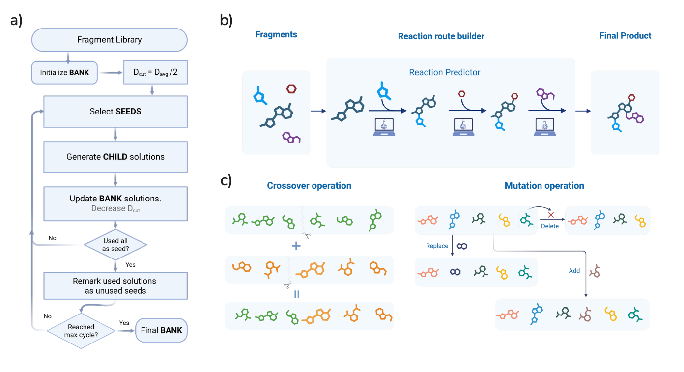

# RxnMol: Synthesis-Aware Molecular Generation via Reaction-Driven Global Search

RxnMol is a novel molecular optimization framework that operates on **synthesis routes** rather than molecular structures directly. By representing candidates as ordered sequences of commercially available building blocks (fragments), RxnMol ensures that every generated molecule comes with a valid, step-by-step synthesis pathway predicted by a neural reaction model.



## Research Overview

### The Core Idea
Traditional de novo design methods often generate "unmakeable" molecules. RxnMol solves this by optimizing the **recipe** instead of the **result**.

- **Genotype**: Ordered list of fragments `[F₁, F₂, ..., Fₙ]`
- **Phenotype**: The molecule resulting from reacting these fragments sequentially `F₁ + F₂ → I₁ + F₃ → ... → Final Molecule`
- **Optimization**: Conformational Space Annealing (CSA) searches the combinatorial space of fragment sequences.

### Key Features
- **Synthesizability**: All intermediates and final products are validated by a forward reaction prediction model.
- **Explicit Pathways**: Output includes the exact recipe (reactants and order) to make the molecule.
- **Controllable Complexity**: Route length constraints (e.g., 2-5 steps) directly control synthetic complexity.
- **High Performance**: GPU-accelerated batch reaction prediction and caching.

## Installation

### Software versions

The retained molecular-generation environment reports the following versions.
These document the experimental environment; they are not a tested installation
lock for every GPU and objective model.

| Software | Version |
|---|---|
| Python | 3.11.6 |
| RDKit | 2023.09.6 |
| guacamol | 0.5.5 |
| PyTDC | 1.1.15 |
| PyTorch | 2.4.0+cu121 |
| PyTorch CUDA build | 12.1 |
| NumPy | 1.26.4 |
| SciPy | 1.16.3 |
| scikit-learn | 1.2.2 |
| pandas | 2.3.3 |

### Prerequisite: Install PyTorch & TensorRT
The reaction predictor relies on **Torch-TensorRT** for fast inference code. You must install the version of PyTorch and TensorRT compatible with your specific CUDA version (e.g., CUDA 12.x).

Recommend to setup a new environment before installing.
```bash
# Clone the repository
git clone https://github.com/snu-lcbc/RxnMol.git
cd RxnMol

# Install dependencies
pip install -r requirements.txt
# Or if you need torch=2.4.0 wit cuda=12.1
# pip install -r requirements_full.txt

# Install the package in development mode
pip install -e .
```
> **Note**: TDC requires `numpy<2.0` and `scikit-learn==1.2.2`. These are pinned to avoid compatibility issues with TDC's pre-trained models.

### Manual Installations:
If you need to install a specific PyTorch and CUDA version (`torch=2.4.0` `cuda=12.1`): 
```bash
pip install torch==2.4.0 torch-tensorrt==2.4.0 --extra-index-url https://download.pytorch.org/whl/cu121
```
> **Note**: Install `torch` and torch-related packages with compatible versions matching your CUDA version. See [pytorch.org](https://pytorch.org/get-started/locally/) for details.


#### Extra GPU stacks for other methods used in this study.
- **CSearch** needs DGL libs compatible with the same torch/CUDA:
```bash
pip install dgl==2.4.0 -f https://data.dgl.ai/wheels/torch-2.4/cu121/repo.html
```
- **SynFlowNet** needs PyG libs matching torch 2.4.0 + CUDA 12.1:
```bash
pip install torch_geometric pyg_lib torch_scatter torch_sparse torch_cluster torch_spline_conv \
  -f https://data.pyg.org/whl/torch-2.4.0+cu121.html
```
> These GPU libraries are ABI‑tied to specific CUDA/torch builds. If your CUDA version differs, use the corresponding wheel URLs/versions so everything stays compatible.

## Architecture

The codebase is organized in `src/rxnmol`:

```
src/rxnmol/
├── core/
│   ├── engine.py          # CSAEngine: The optimization loop
│   ├── data_models.py     # Candidate, RunContext
│   └── config.py          # Configuration management
├── solutions/
│   ├── fragments_route.py # FragmentRouteSpec: Synthesis logic
│   ├── smiles_based.py    # SmilesDirectSpec: Raw SMILES optimization
│   └── reaction_model.py  # RxnPredictor: Transformer model
├── objectives/            # Objective functions (GuacaMol, TDC, etc.)
├── runtime/               # Metrics and artifact storage
└── utils/                 # Helper utilities
```

## Usage

### Running an Experiment

```bash
python run.py --config configs.yaml --objective seh
```

### Configuration Example

```yaml
# configs.yaml
csa:
  bank_size: 100
  seed_size: 60
  max_iter: 100

solution:
  spec_type: fragment_route  
  min_fragments: 2
  max_fragments: 5

objective:
  name: seh # name of objective functions 

runtime:
  device: cuda    # Use GPU for reaction prediction
```

### Settings used in the experiments

| Configuration key | Bank 100 | Bank 500 | Bank 1,000 |
|---|---:|---:|---:|
| `csa.seed_size` | 60 | 300 | 600 |
| `csa.max_iter` | 100 | 500 | 500 |
| `csa.early_stop_patience` | 50 | 50 | 50 |
| `csa.d_init` | 0.6 | 0.6 | 0.6 |
| `csa.gamma` | 0.99 | 0.99 | 0.99 |
| `csa.d_min` | 0.1 | 0.1 | 0.1 |
| Maximum attempted offspring per generation | 1,500 | 7,500 | 15,000 |

Each seed uses five crossover attempts against the current bank
(`csa.n_cross_op1`), five against the initial bank (`csa.n_cross_op2`), and five
mutation attempts (`csa.n_mut_op`). A crossover can return two children and a
mutation one. These are attempt limits, not counts of objective evaluations or
unique products.

For fragment-route search, the engine selects uniformly between the two crossover
operators and among the three mutation operators. The generic `operators`
probability fields, weights, and name lists do not control these choices.
Mutation positions use weight 0.2 for the first building block and 1.0 for other
positions; this is separate from selection of the mutation type.

The initial bank receives one local-refinement pass, with
`csa.local_optimization_max_steps=3` and `csa.local_optimization_neighbors=5`.
`csa.local_optimization_enabled=false` disables refinement during the search loop,
but not that initial pass. Search stops at the generation limit, after 50
generations without improvement in the best objective, or when no unused seeds
remain. Normal termination writes the final bank. Original runs used
`runtime.random_seed=null`; fixed seeds in later repairs or ablations must be
identified with those runs.

### Preparing building blocks

Building block library can be found in `data/enamine_fragments.smi`.

[`scripts/prepare_building_blocks.py`](scripts/prepare_building_blocks.py)
accepts SDF and SMILES, performs RDKit parsing and sanitization, removes explicit
hydrogens, and writes canonical isomeric SMILES with per-record outcomes:

```bash
python scripts/prepare_building_blocks.py --input data/enamine_fragments.smi \
  --output prepared/enamine_fragments.smi --report prepared/report.json \
  --records prepared/records.csv
```

### Code Example

```python
from rxnmol.core import MasterConfig, RunContext, CSAEngine
from rxnmol.solutions import FragmentRouteSpec
import numpy as np

# 1. Load Configuration
config = MasterConfig.from_yaml("configs.yaml")

# 2. Initialize Context
rng = np.random.default_rng(42)
context = RunContext(config=config, rng=rng)

# 3. Initialize Solution Specification
spec = FragmentRouteSpec(context)

# 4. Initialize Engine
engine = CSAEngine(spec, context)

# 5. Run Optimization
best_candidate = engine.run()

print(f"Best Score: {best_candidate.objective_value}")
print(f"Molecule SMILES: {best_candidate.smiles}")
print(f"Synthesis Route: {best_candidate.genotype}")
```

### Available Objectives

| Category | Objectives |
|----------|-----------|
| Standard | `qed`, `sa_score`, `logp`, `lipinski` |
| GuacaMol | `zaleplon`, `osimertinib`, `fexofenadine`, `ranolazine`, ... |
| TDC bioactivity | `jnk3`, `gsk3b`, `drd2`, ... |
| MPNN docking proxies | `seh`, `cb1_raw`, `cb1_zscore`, `cb1_minmax` |
| GNN docking proxies (CSearch) | `mpro`, `btk`, `alk`, `h1n1_na` |
| Custom | Define your own via `ObjectiveFunction` base class |

The docking-proxy objectives also have `_lipinski` and `_mw` variants, such as
`seh_lipinski` and `alk_mw`, which apply the corresponding property penalties.

Check all available objective functions:
```bash
python src/rxnmol/objectives/registry.py
```

## Reaction Prediction Model

The [`reaction_model/`](reaction_model/README.md) directory contains the model
used in the manuscript: Synthetic-RXN pretraining followed by USPTO-MIT
fine-tuning with synthetic replay (`ft_synth_to_uspto_mix90_10`). It provides
training recipes, the saved tokenizer, exact dataset preparation, evaluation
code, software versions, and checkpoint identities.

The two raw reaction corpora and required checkpoints are identified by filename
and checksum in the [asset manifest](reaction_model/reference/assets.json).
From the repository root, download and verify both datasets and checkpoints with:

```bash
python reaction_model/scripts/download_assets.py
```

The default is [release v1.1.0](https://github.com/snu-lcbc/RxnMol/releases/tag/v1.1.0).
Use `--local-dir PATH` for files already downloaded, or `--release-tag TAG` to
select another release with matching asset checksums. See the
[asset preparation instructions](reaction_model/README.md#files-and-data).

### Model Weights

The reaction prediction model weights are required for fragment-based optimization. Download from:

- [Deployment, proxy, and docking weights](https://doi.org/10.5281/zenodo.20444600)

The evaluated checkpoint and the final deployment weights are identified separately
in [reaction_model/README.md](reaction_model/README.md).


## License

MIT License

## Citation

If you use RxnMol in your research, please cite:

```bibtex
@article{rxnmol2025,
  title={Synthesis-Aware Molecular Optimization: A Data-Driven Approach to de novo Molecular Generation},
  author={Ashyrmamatov, Islambek and Ucak, Umit V. and Lee, Juyong},
  year={2025}
}
```
